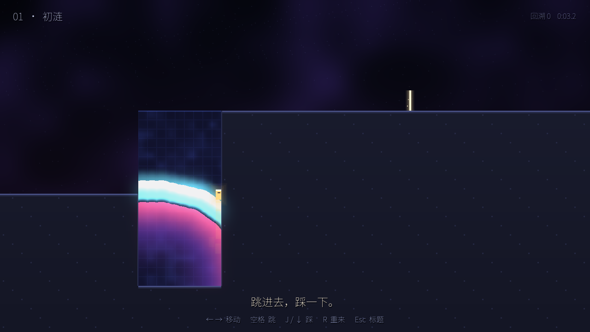
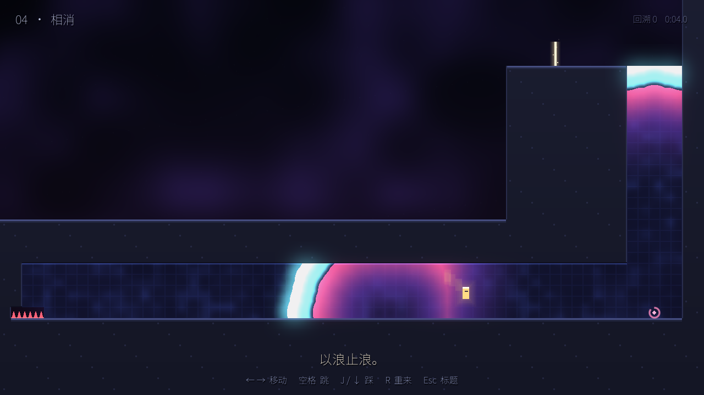
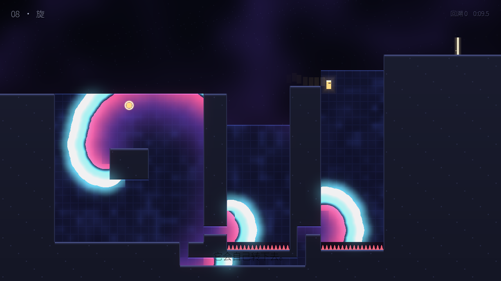

# 涟 · Ripple —— 可玩原型 v0.1

> 你每踩一步，脚下的“活膜”就荡开一圈光环，**只有亮着的那一圈能站人**。你要骑着自己激起的波往上走，借两道波相撞、穿过缝隙、被障碍切开这些现象开路。

参加 TapTap 聚光灯（主题“涌现”）的 PC 横屏跑酷解谜原型。Godot 4.3，所有画面和声音都由代码生成（着色器 + 程序合成音效），没有任何美术素材文件。



---

## 怎么玩

| 按键 | 作用 |
|---|---|
| ← → / A D | 移动 |
| 空格 / W / ↑ / K | 跳（站在上升的波顶上起跳会跳得更高） |
| J / S / ↓ / X | **踩**：只能踩在实地上（墙、门、坝），点亮脚边的活膜 |
| R | 立刻重来本关 |
| Esc | 回到标题（标题里 ← → 选已解锁的关） |
| M | 静音 |

**运行方式**

- **Windows 直接玩**：解压仓库里的 `build/Ripple-Windows.zip`，双击 `Ripple.exe`。
- **用 Godot 打开**：Godot **4.3**（标准版即可，不需要 .NET），导入 `ripple/project.godot`，按 F5。
- 进度保存在 `user://ripple_save.cfg`（每通一关解锁下一关）。

## 全部规则

活膜由 64×36 个格子组成，每格只有三种状态：

| 状态 | 外观 | 能否站人 | 规则 |
|---|---|---|---|
| **静** | 深靛蓝，细格纹 | 不能，会掉下去 | 被玩家踩到，或邻格亮着，就点亮 |
| **亮** | 白蓝高光 | **能站** | 只亮 0.26 秒，然后变“倦”；点亮时把邻格排进队列 |
| **倦** | 品红→紫的余晖 | 不能 | 1.1 秒内不能再被点亮，之后回到“静” |

再加四种场景元素：**墙**（挡人也挡波）、**刺**（碰到就重来）、**钟**（被波点亮时敲响，所有钟都响后，**门**变成空气、**坝**变成活膜）、**起搏器**（按固定周期自己点亮一格）。

规则就这些。下面这张表里的每一种现象，代码里都**没有专门写**，全是这几条规则跑出来的结果：

| 现象 | 从哪条规则来 | 在哪关第一次用到 |
|---|---|---|
| 圆环向外扩散，环的上弧能当电梯 | “亮”传给邻格 + 亮格是实心的 | 01 初涟 |
| 波沿着通道走到远处的池子 | 传播只走活膜 | 02 接力 |
| 波从一格宽的缝里钻过去，在另一边重新长成半圆 | 同上（惠更斯原理） | 03 穿隙 |
| 波自己走完迷宫（它本来就会走最短路） | 同上 | 03 穿隙 |
| 两道波相撞，互相抵消 | 波的身后全是“倦”，过不去 | 04 相消 |
| 刚被波扫过的地方踩不亮 | “倦” | 05 抢拍 |
| 路越长，波到得越晚，形成天然的节拍器 | 传播速度恒定 | 06 迟到的浪 |
| 只朝一个方向走的波在环路里永远转下去 | 坝挡住一边 + 钟开坝 + “倦” | 07 回环 |
| 开阔的介质里，绕岛转的波甩出**螺旋** | 同上，外圈路程更长所以落后 | 08 旋 |
| 一颗“心”自己按节律跳动 | 同上 | 09 心跳 |

## 九关一览

| # | 名字 | 学到什么 | 关键的“意外” |
|---|---|---|---|
| 01 | 初涟 | 跳进去，踩一下，被托上去 | 原来波能站 |
| 02 | 接力 | 在波顶起跳更高；波会沿着暗道去到隔壁池子 | 隔壁那个底下是刺的池子，也被你的波推起来了 |
| 03 | 穿隙 | 钟和门；波穿过 1 格宽的缝 | 站在门口看你的波自己在墙里走完迷宫 |
| 04 | 相消 | 起搏器不停发波，会把你推进刺里；踩一下迎上去，两道波互相抵消 | 最后要骑着“敌人”的波上去 |
| 05 | 抢拍 | 上面的起搏器往下发波，扫过的膜暂时踩不亮 | 要在“倦”退去、下一拍来到之前的空隙里踩 |
| 06 | 迟到的浪 | 一次踩，三座电梯；藏在柱子里的弯路让波晚到 | 看着光在柱子里绕圈，等它出现 |
| 07 | 回环 | 钟开坝。在离坝近的地方踩，波只朝一个方向走，回到起点时那里已经休息好了 | 它不再停下来。在钟旁边踩会失败：两道波绕一圈后对撞，一起消失 |
| 08 | 旋 | 开阔活膜里的回环会甩出螺旋，一遍遍推起远处两座底下是刺的电梯 | 螺旋是自己长出来的 |
| 09 | 心跳 | 一颗停跳的心：在对的地方踩，它重新跳起来，一下一下把你送进右边那条长血管 | 结局：整颗心随着节律搏动 |





---

## 这个游戏如何表达“涌现”

以下说明只依据**原型里已经实现、并经过自动回放验证**的内容。没有经过真人试玩的部分单独列出。

### 已实现、已验证的部分

1. **玩家亲手做出来的“整体大于部分”。** 玩家学到的规则始终只有一句：“踩一下会亮，亮了会传，传完会累”。但他在关卡里实际用到的电梯、抵消、衍射、节拍器、回环、螺旋，**没有一个是单独写进代码的机关**。`scripts/medium.gd` 只有大约 200 行，里面只有这三种状态和一个事件队列。第 7、8、9 关里永不停歇的回环，是“只朝一个方向走的波”遇到“已经休息好的格子”自然长出来的。`tools/verify_all.gd` 验证了这一点：同一关里，在钟旁边踩，波只经过探针 **1 次**；在坝旁边踩，波会**反复经过**（第 7 关 3 次以上，第 9 关 5 次，第 8 关 7 次）。代码完全一样，结果不同，差别只在玩家踩的位置。
2. **“涌”的字面意思。** 每一步都有东西从脚下涌出来，路本身就是涌出来的。第 1 关的唯一提示是“跳进去，踩一下”。
3. **从“我造成波”到“波自己产生波”。** 第 1–6 关里，所有的波都来自玩家这一脚，或者来自固定的起搏器。第 7 关开始，玩家造出一个离开后仍然不停的东西：先是一圈环路，然后是螺旋，最后是一颗心。第 7 关和第 9 关的谜底本身就是一个关于涌现的问题：**为什么同样踩一下，在这里会消失，在那里会永远转下去？**（答案是先到的那一边决定方向，见下一节“设计中的取舍”。）
4. **规则逼玩家依赖涌现出来的东西。** “只能踩在实地上”这条限制，让底下是刺的池子、竖井和血管只能靠别处传来的波托起来。第 8、9 关的远处电梯只靠一次踩不够用（时机几乎接不上），需要一个能自己转下去的东西。
5. **结局**把这层意思说出来：“没有谁规定心跳。每一格只知道：被点亮，传下去，然后休息。节律是从它们之间涌现出来的——就像你的路。”

### 仍待真人验证的设想

- 玩家能不能**不看说明、只靠操作**理解“倦”和“方向由先到的一侧决定”。第 7 关第一次失败后，玩家可能不知道该按 R 重来。目前只有一句提示诗：“先到的，决定方向。”
- 骑波的手感：波每 0.11 秒前进一格，靠插值和“被托时继承波速”让人物移动平滑，但没有在真人手上测过。
- 第 8、9 关不造回环、只靠一次踩，在极限时机下仍有可能通关（自动探索在几百次随机尝试里找到过一次）。我认为这是可以接受的高手打法，但需要真人判断。
- 完整时长：自动回放最快 6–24 秒一关。真人第一次玩的时长没有测过，估计 15–30 分钟，离目标的 40–60 分钟还差 6–10 关。

---

## 设计中的取舍（制作时发现的问题）

- **站在波上不能踩。** 最早允许“站在波上再踩”，自动探索马上发现，这样在任何开阔水域都能一路踩上去，起搏器和回环都变成了可有可无。改成只能踩实地以后，“远处的电梯只能靠别处来的波”才成立，涌现出来的东西才真正有用。
- **第 2 关的暗道只有一格高**，因为人物 22 像素、一格 20 像素。原来的两格高通道会让人走进刺池。
- **第 6 关的池子宽 9 格**，超过跳跃距离，否则人直接跳过去，波就没用了。
- **第 7 关：先到的决定方向。** 钟放在入口旁边、坝在远处，第一次自然的落点踩下去，两道波会先敲响钟、开坝，然后两边对称地绕一圈对撞消失。要在靠近坝的地方踩，让朝坝去的那一半先被挡住，只留下一个方向。

## 工程结构

```
ripple/
├── project.godot            Godot 4.3，Compatibility 渲染器（兼容性最好）
├── scenes/main.tscn         只挂一个脚本，其余节点都由代码生成
├── scripts/
│   ├── medium.gd            活膜：三条规则 + 连续时间事件队列（16 邻域，波是圆的、可复现）
│   ├── player.gd            玩家：格子碰撞、被波托起/推开、踩
│   ├── level.gd             解析字符地图，钟/门/坝/起搏器/出口/刺，以及特效
│   ├── levels.gd            九关字符画（由 tools/make_levels.py 生成，也可以直接手改）
│   ├── main.gd              标题、选关、HUD、结局、存档、自动截图/回放
│   └── sfx.gd               程序合成的音效与环境音
├── shaders/
│   ├── medium.gdshader      从每格的“点亮时刻”重建平滑圆润的波前与辉光
│   └── background.gdshader  背景渐变、光团、尘点
├── fonts/                   思源黑体 SC（Noto Sans SC）的子集（GB2312 全部汉字），OFL 许可
├── tools/                   关卡生成器与验证工具（不会打包进游戏）
└── docs/                    截图
```

**改关卡**：编辑 `tools/make_levels.py`，然后运行 `python3 tools/make_levels.py` 重新生成 `scripts/levels.gd`；也可以直接改 `levels.gd` 里的字符画。字符含义写在 `scripts/level.gd` 顶部。

**调手感**：波速、“亮”和“倦”的时长在 `medium.gd` 顶部；跑速、跳跃、重力在 `player.gd` 顶部。

## 验证

```bash
# 一键回归：活膜性质 + 九关通关回放 + 回环/非回环判定
godot --headless --path ripple -s tools/verify_all.gd
```

最近一次结果（全部通过）：

```
活膜：
  PASS  1 秒后波前半径≈9 格（实测 9.0）
  PASS  两道波对撞后互相湮灭，8 秒后全场平静
通关回放：
  PASS  第 1–9 关全部 WIN（6.3 / 9.8 / 10.1 / 10.3 / 24.0 / 10.8 / 22.6 / 12.7 / 13.6 秒）
第 7 / 9 / 8 关的回环：
  PASS  错的位置：只经过 1 次；对的位置：反复经过 3 / 5 / 7 次
```

其他工具：`tools/run_replay.gd`（单条回放加轨迹）、`tools/probe.gd`（记录某几格什么时候被点亮）、`tools/explore.gd`（随机探索找通关路线）、`tools/batch_replay.gd`（批量试时机）。

自动验证**不能代替**真人对趣味、手感和审美的判断。Windows 包由 Godot 4.3 官方模板导出，没有在真机上启动过。

## 下一步建议

1. 真人试玩前 3 关，重点看能不能不靠说明就学会“踩—骑—在波顶起跳”。
2. 第 7 关失败后，加一个更明显的提示，比如钟和坝之间的连线闪一下“方向”。
3. 往 40–60 分钟扩展：两颗心相互同步、多个起搏器互相竞争频率（频率高的会占领整片活膜）、可以搬动的“小岛”（让玩家自己摆出回环的形状）。
4. 第 1 关开头加一个 3 秒的无文字演示（比如一个幽灵小人示范踩一下）。

## 许可

- 代码：随仓库。
- 字体：Noto Sans SC，SIL Open Font License 1.1（见 `fonts/OFL.txt`）。
