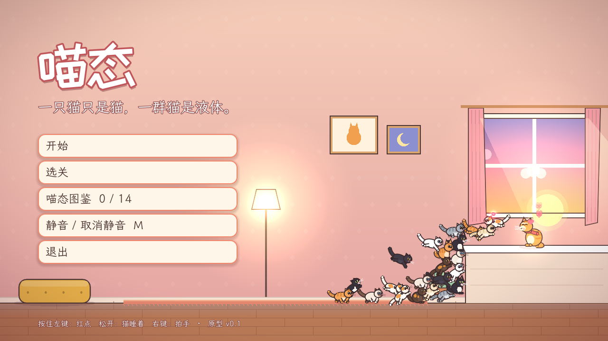
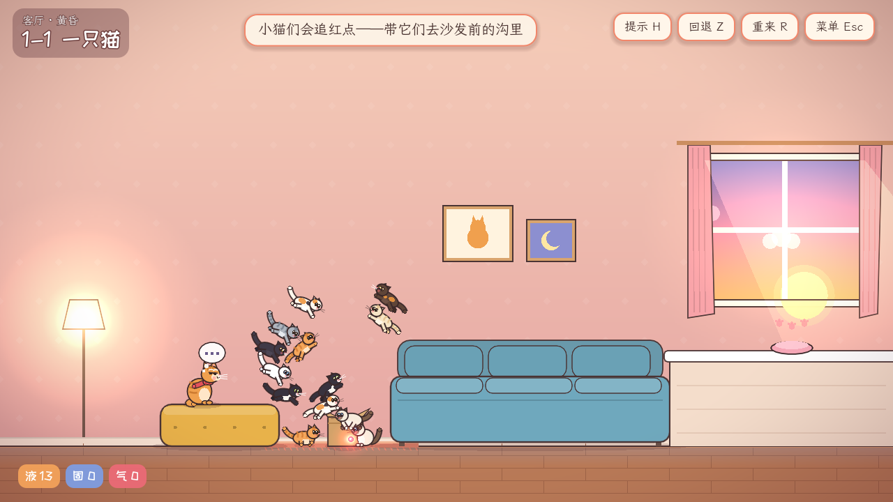
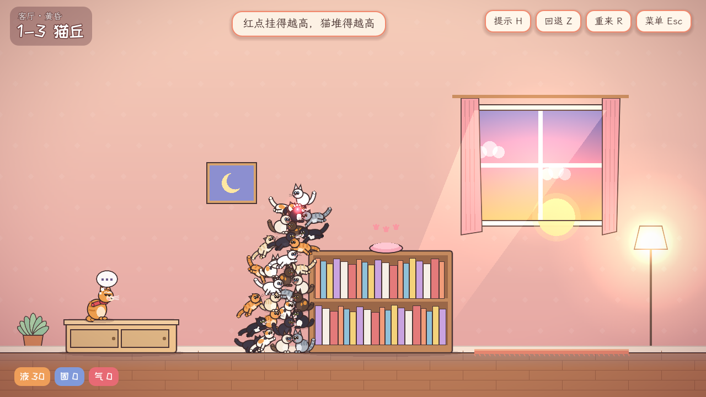
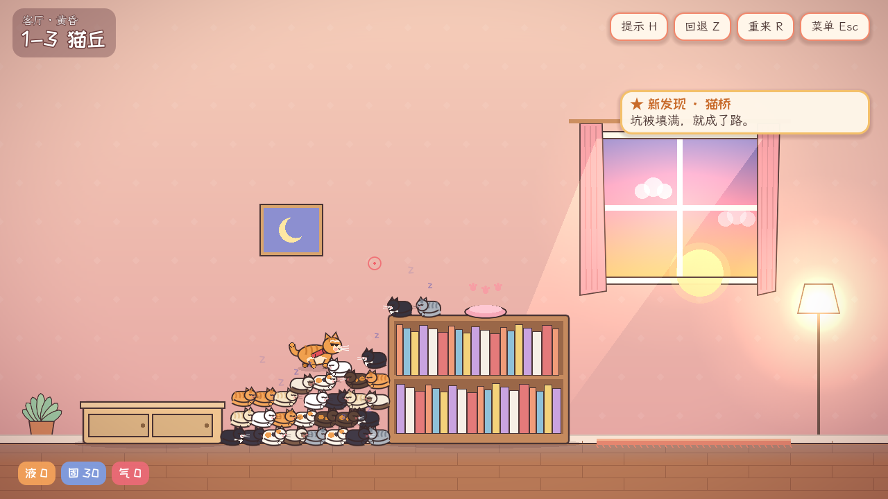
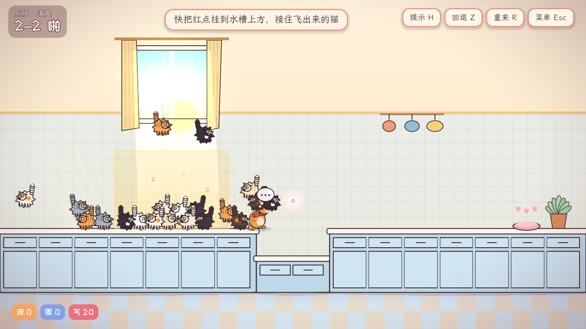
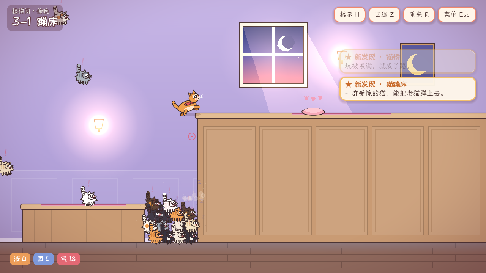

# 喵态 · 独立原型 v0.1

> 一只猫只是猫。一群猫，是水，是路，是台阶，也是一张会炸开的蹦床。

《喵态》是一个 PC 单机横屏解谜原型（Godot 4.7，纯 GDScript）。点子来自另一位 Opus 的提案“喵态”（激光笔 = 液态、睡觉 = 固态、拍手 = 气态，护送走不动路的老猫阿黄），本批次把它做成了能玩的版本，并对规则做了一轮完善。



---

## 怎么玩

**Windows 试玩**：解压 `试玩版/喵态-v0.1-windows.zip`，双击 `Miaotai-v0.1/Miaotai.exe`。exe 没有签名，第一次运行时 Windows 可能提示“未知发布者”，点“更多信息 → 仍要运行”即可。

**从源码运行**：用 Godot 4.7 或更新版本（标准版即可，不需要 .NET）导入 `godot/project.godot`，按 F5。

全程只用鼠标：

| 操作 | 作用 |
|---|---|
| 按住左键 | 放出激光笔红点。看得见红点的小猫会追过去，一群猫追起来像水一样流 |
| 松开左键 | 看不见红点的猫过 0.7–1.25 秒就地揣手睡着。睡着的猫像家具一样结实，可以踩 |
| 红点停在睡猫身上 | 约 0.35 秒后叫醒它（固体被“融化”） |
| 右键 | 拍手。附近的猫炸毛弹开，碰到谁就把谁也吓到 |
| H / Z / R / Esc | 提示（每关三段）/ 回退到上一次“全场安静”的时刻 / 重来 / 菜单 |
| M / F11 | 静音 / 全屏 |

**目标**：把老猫阿黄送到发光的地方。阿黄只会慢慢往前走，一步最多迈上或迈下约两层猫的高度。他不肯跳，不踩冰凉的地板；只要还有小猫醒着在闹，他就坐下来等。

---

## 和原方案相比，我们怎么完善的

原方案的骨架都保留了：激光是液、睡觉是固、拍手是气；老猫只会慢慢走；开场一只猫做不到的事，一群猫能做到。落地时做了下面这些调整，每一条都是为了让“堆出来的东西”自己长出来，而不是写成规则。

1. **物态切换是每只猫自己的感知，不是全局开关。** 猫只追自己看得见的红点（有视线遮挡）；看不见约一秒才睡。所以同一时刻场上可以同时有液和固：把红点藏到家具后面，看不见的那部分猫就地睡成一堵墙，看得见的继续流（“分流”）。
2. **固态有“支撑”。** 睡猫只被身下的睡猫或家具托住；身下那只一醒，上面的就掉下来，掉得够高会摔醒。于是叫醒一座猫塔最底下那只，整座塔会自己“流”下来（“猫雪崩”）。没有任何代码写着“雪崩”。
3. **两种粒度的“化开”。** 红点在一只睡猫身上停一会儿，只叫醒这一只（局部融化）；拍手则一片一片地炸醒。粒度不同，“同一群猫先当这段路、再当下段路”（拆桥再用）才真正可操作。
4. **阿黄多了三条小性格，逼出“先搭好、再放行”的节奏。**
   - 怕凉：不踩地板，路必须是家具或睡猫。
   - 怕吵：只要还有猫醒着，他就坐着等。这样他不会走进搭到一半的结构，玩家的节奏也变成“搭 → 松手 → 安静 → 阿黄走”。
   - 步高从“一只猫高”放宽到约两层猫：猫堆表面总是坑坑洼洼的，一层太苛刻，试玩手感很差。
5. **阳光是模具。** 晒到太阳的猫落地就睡，红点叫不醒。猫群倒进光里会按光的形状凝固（“晒成形”）；要把晒住的猫弄出来，只能拍手变成气态。这给拍手找到了非用不可的理由（厨房两关）。
6. **惊慌是接触传染的。** 拍手只吓到附近的猫，受惊的猫再吓到贴着它的猫，越挤弹得越猛：密的猫堆一路连锁，稀的传不开。阿黄脚下受惊的猫越多，他被弹得越高（“猫蹦床”）。弹多高不是写死的，是从脚下“数”出来的。
7. **开场纸箱（原方案的前 30 秒）。** 1-1 只有一只猫，它够不着；它追着红点撞到纸箱，纸箱翻开，倒出 15 只。“一只猫是猫，一群猫是液体”成了玩家亲手做出来的第一件事。
8. **喵态图鉴。** 14 种现象（猫流、猫丘、定形、猫桥、猫阶、融化、猫雪崩、分流、拆桥、连锁炸毛、传不开、猫蹦床、晒成形、踩背）都不在规则里，游戏只在它们真的发生时认出来、记下来。没见过的条目只给线索，不给答案。
9. **快速重试。** Z 回到上一次“全场安静”（猫都睡了、阿黄站稳）的时刻，R 重来，H 三段式提示由浅入深。关卡里的小提示看情况出现（比如阿黄等太久，会提示“叫醒挡路的猫，或按 Z”）。
10. **体量先收。** 原方案规划 5 章，v0.1 先做 4 章 9 关，把核心循环验证扎实。



---

## 关卡（4 章 9 关，每关只加一个新点子）

| 关 | 名字 | 新东西 | 这一关想让玩家发现的 |
|---|---|---|---|
| 1-1 | 一只猫 | 红点、松手定形、纸箱开场 | 一只猫跳不上去，一群猫可以；松手的那一刻，流动的形状成了路 |
| 1-2 | 猫塔 | 叫醒（融化）、支撑 | 叫醒最底下那一只，整座猫塔会流下来 |
| 1-3 | 猫丘 | 红点的高度和位置 | 红点挂得越高猫堆得越高；挂在墙边才是坡，挂在中间只是一个包 |
| 1-4 | 拆桥 | 重复使用 | 猫不够铺两段路：同一群猫先当这段，再当下一段 |
| 2-1 | 晒 | 阳光 | 光照到哪儿，猫就在哪儿凝固；要从近处慢慢倒进去 |
| 2-2 | 啪 | 拍手（气态） | 晒住的固体，一声“啪”变成气体；挤得越密，惊得越远 |
| 3-1 | 蹦床 | 拍阿黄脚下 | 一堆受惊的猫能把老猫弹上去；猫越多越挤，弹得越高 |
| 3-2 | 上楼 | 组合 | 同一群猫：先是水，再是桥，最后是弹簧 |
| 4-1 | 看月亮 | 综合 | 多解：在烟囱前堆陡坡一级级爬，或站上坡顶被拍上去 |




---

## 这个游戏如何表达涌现

### 规则只写在“一只猫”身上

每只小猫只有这几条习性（`godot/scripts/sim.gd` 开头写着同样的清单）：

- 看得见红点就追过去，够不着就往上扑；
- 看不见红点一会儿就地睡着，睡着的猫是结实的；
- 红点在睡猫身上停一会儿就叫醒它；
- 被拍手或被受惊的同伴撞到就炸毛弹开，周围越挤弹得越猛；
- 晒到太阳马上睡着，红点叫不醒；
- 睡着时身下没了支撑就掉下去，摔得够高就醒。

阿黄只有四条：慢慢往前走、一步最多两层猫高、不踩地板、周围吵就等。

代码里没有“堆坡”“搭桥”“台阶”“雪崩”“连锁”“蹦床”这些东西。它们全部是很多只猫各自照着习性行动、互相推挤后，在画面上“长”出来的。

### 玩家看到并且要利用的“东西”（已实现，自动验证里都出现过）

| 现象 | 从哪几条规则里长出来 | 在哪儿用到 |
|---|---|---|
| 猫流 | 一群猫追同一个点 + 互相挤 | 每一关：把猫“倒”进沟里 |
| 猫丘 | 够不着就往上扑 + 踩着同伴；松手后塌成自然的坡度 | 1-3、2-1、3-x、4-1 |
| 定形 | 液 → 固只由“看不见红点”触发 | 松手的瞬间，流动的形状变成地形 |
| 猫桥 / 猫阶 | 睡猫可以踩 + 阿黄的步高 | 填沟、上台阶 |
| 猫雪崩 | 支撑 + 摔醒 | 1-2、4-1 推倒猫塔 |
| 分流 | 视线遮挡 + 看不见就睡 | 藏红点，让一部分猫留下当墙 |
| 拆桥 | 固 → 液可逆（叫醒、拍手） | 1-4、3-2、4-1：猫不够，必须重复使用 |
| 连锁炸毛 / 传不开 | 接触传染 + 密度放大 | 2-2：同一个拍手，密堆传遍，稀堆传不开 |
| 猫蹦床 | 受惊的猫撞到阿黄 + 数量叠加 | 3-1、3-2、4-1 |
| 晒成形 | 阳光秒睡 | 2-1、2-2：光的形状就是模具 |
| 踩背 | 阿黄也是能站的东西 | 小猫会自己爬到阿黄背上当台阶 |

### 解谜的方式本身就是“和涌现合作”

关卡里没有要找的开关，也没有要拼的固定零件。玩家要做的是**预测一群猫会长成什么形状**，再用红点的位置、高度、停留时间和松手的时机去“塑形”：

- **思考**：这里要的是平的桥还是往上的坡？猫够不够同时铺两段？哪一堆挤得够紧，一拍就能传遍？
- **实践**：红点挂高一点、往墙边靠一点、早一点松手，堆出来的形状就不一样。每次都会有点不同，所以按 Z 回到安静时再试一次很便宜。

1-3 是这件事最纯粹的例子。同样是 30 只猫：红点挂在书架边的墙上，猫会顺着墙堆成坡，松手后塌出一道阿黄爬得上去的斜坡；红点放在沟底只能把沟填平，挂在沟中间只会堆出一个包。后两种在自动验证里都过不去。




### 已实现 / 还需要真人验证

**已实现并经自动验证**（见下一节）：

- 9 关都能只用游戏自己的操作通关，而且对“手不准”有容错；
- 每关想教的那个点子是必需的：“什么都不做”“只填平”“只用红点不拍手”“只堆坡不拍手”这类绕开点子的打法都过不去；
- 上表里的现象在验证跑局中都被图鉴识别到过；
- 4-1 两条上烟囱的路线都出现过：基础跑局是站上坡顶、被拍上去；扰动跑局里也有在烟囱前堆出陡坡、一级级爬上去，一下都没拍手的。

**只能靠真人试玩回答**：

1. 不看提示时，玩家能不能自己想到“挂高红点 = 堆坡”“叫醒最底下那只”“在阿黄脚下拍手”？提示和图鉴线索的分寸对不对？
2. 涌现带来的不确定，对玩家来说是乐趣（“这次堆得不一样”）还是挫败（“明明一样的操作”）？Z 回退够不够弥补？
3. 阿黄“怕吵”坐着等，是让人有掌控感，还是觉得拖沓？
4. 真人每关要多久？v0.1 九关的总时长还没测，距离 40–60 分钟的目标体量还差多少？
5. 图鉴能不能驱动玩家回头用别的办法再玩一遍（每关都写了“另一种办法”的结算语）？
6. 第 4 章“多解”的感觉，玩家能不能体会到？

---

## 自动验证

```
godot --headless --path godot --script res://tests/verify.gd -- 验证/verify.json all 16
```

- 验证脚本和真人走**同一套模拟和输入通道**（红点、松手、拍手），每关有分阶段的脚本解法。后一阶段会等“阿黄停下来、全场安静”才开始，像真人一样看情况再动手。
- **扰动**：每个解法再跑 16 次，所有输入整体偏移 ±10px（纵向 ±8px）、时间偏移 ±0.25 秒，模拟“手不准”。
- 脚本里带两个真人也会做的小动作。一是“修路”：阿黄被一只猫挡住，或站在猫堆上而前面一下子低下去时，把相关的那只猫叫醒挪开。二是重拍：拍手没把阿黄弹上去时，按 Z 回到拍手前，换个位置再拍（最多 3 次）。
- **反例**：每关都有一两种绕开本关点子的打法，必须失败。

最终结果（Godot 4.7.2，详见 `验证/verify.json` 与 `验证/verify_log.txt`）：

| 关 | 解法 | 基础跑局 | 扰动 16 次 | 必须失败的打法 |
|---|---|---|---|---|
| 1-1 | 沟里靠沙发 / 沟中间 | 过（21.8 秒） | 16/16 · 16/16 | 什么都不做 ✗ |
| 1-2 | 推倒三座塔再填沟 | 过（17.5 秒） | 16/16 | 什么都不做 ✗、只叫醒塔顶一只 ✗ |
| 1-3 | 红点挂高处 / 慢慢抬高 | 过（18.0 秒） | 16/16 · 16/16 | 什么都不做 ✗、只填平沟 ✗、挂在沟中间 ✗ |
| 1-4 | 先填第一道再挪 | 过（53.1 秒） | 16/16 | 一次全堆进第二道 ✗ |
| 2-1 | 先倒满水槽再堆坡 | 过（36.0 秒） | 15/16 | 什么都不做 ✗ |
| 2-2 | 拍两次再填水槽 | 过（33.2 秒） | 16/16 | 只用红点 ✗ |
| 3-1 | 靠墙堆坡再拍手 | 过（21.1 秒） | 16/16 | 只堆坡不拍手 ✗ |
| 3-2 | 铺桥-拍醒-堆坡-蹦床 | 过（38.9 秒） | 16/16 | 什么都不做 ✗ |
| 4-1 | 推塔-填沟-拍醒-堆坡-蹦床 | 过（48.1 秒） | 15/16 | 什么都不做 ✗ |

合计：11 个解法基础跑局全过，扰动跑局 174/176，12 种必须失败的打法全部失败。

没过的 2 次扰动跑局都是“差一点”：2-1 最后的坡比高柜低了 5px；4-1 有一次阿黄停在烟囱脚下，身下只剩三只猫，弹不够高。真人会补一只猫或重堆，脚本不会。

这些数字说明的是“可解、有容错、点子是必需的”，**不说明好不好玩、多久能想到**。那要靠真人试玩。

---

## 文件结构

```
2026-10-07-喵态-独立原型-v0.1/
├── README.md                 本文件
├── 试玩版/喵态-v0.1-windows.zip   Windows 可执行版（单个 exe，已内嵌资源）
├── 截图/                     关键画面
├── 验证/verify.json          自动验证报告（verify_log.txt 是整理过的控制台输出）
├── tools/
│   ├── build_levels.py       关卡与验证解法的唯一来源 → 生成 levels.json 和 solutions.json
│   └── subset_fonts.py       按游戏里实际用到的字裁剪字体
└── godot/                    Godot 4.7 工程
    ├── project.godot / export_presets.cfg
    ├── scenes/main.tscn
    ├── scripts/
    │   ├── sim.gd            核心模拟（确定性，60Hz 定步长；小猫、阿黄、拍手、阳光、支撑）
    │   ├── game.gd           一关的画面、输入、HUD、提示、回退
    │   ├── main.gd           标题、选关、图鉴、结局、存档
    │   ├── discover.gd       图鉴：在现象真的发生时认出来
    │   ├── art.gd / deco.gd  全部美术（用代码画：小猫姿态、阿黄、家具、房间、光）
    │   ├── audio.gd          全部声音（程序合成：喵、呼噜、拍手、八音盒旋律）
    │   ├── autoplay.gd       脚本化输入（验证、截图共用）
    │   ├── levels.gd / ui.gd / draw_layer.gd
    ├── levels/levels.json    生成的关卡数据
    ├── tests/verify.gd       自动验证；lab.gd 单关实验台；solutions.json 生成的解法
    └── fonts/                裁剪后的字体 + OFL 授权
```

### 改关卡 / 改文字

1. 改 `tools/build_levels.py`，然后运行 `python3 tools/build_levels.py`。
2. 改过任何界面文字或关卡提示后，运行 `python3 tools/subset_fonts.py <LXGWWenKai-Regular.ttf> <ZCOOLKuaiLe-Regular.ttf>` 重新裁剪字体，否则新字会显示成方块。
3. 运行上面的验证命令，确认解法仍能通过、反例仍然失败。
4. 导出：Godot 里用 `Windows Desktop` 预设（已设置把 `levels/*.json` 打进包、排除 `tests/`）。

---

## 素材与授权

- 美术：全部由代码实时绘制（`art.gd`、`deco.gd`），没有使用外部图片；图标是手写的 `icon.svg`。
- 声音：全部程序合成（`audio.gd`），没有使用外部音频。
- 字体：霞鹜文楷 LXGW WenKai、站酷快乐体 ZCOOL KuaiLe，均为 SIL Open Font License 1.1，已按用到的字裁剪；授权文本见 `godot/fonts/`。

## 已知问题与下一步

- 小猫物理是自写的轻量 PBD，目前一关最多 31 只猫；没有专门测帧率，猫更多时的性能也没有测过。
- 图鉴偶尔会被“顺手”触发（比如 2-1 开局有小猫自己跳到阿黄背上，直接记下“踩背”）。这些都是真发生的现象，但不一定是玩家有意做出来的。
- 声音是程序合成的占位品质，第二轮可以换成录制的猫叫。
- 只提供 Windows 版（工程里也有 Linux 导出预设）。
- 下一步：先做真人试玩（重点看上面“只能靠真人试玩回答”的 6 个问题），再决定第 5 章做什么、哪些现象值得单独做成一关。
